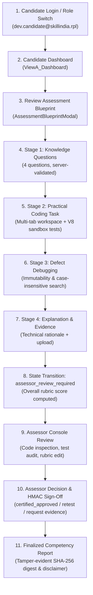

# Kaushal AI — Web Developer Practical Skill Verification Platform

## 1. Product Vision & Overview

Kaushal AI has been enhanced from an initial RPL concept into an operational, job-based **practical skill verification platform**. 

### First Supported Occupation: **Web Developer**
- **Qualification Pack:** `SSC/Q0501` (Web Developer)
- **Sector:** IT-ITeS Sector Skill Council
- **NSQF Level:** Level 5
- **Assessment Approach:** **Hybrid Model** — Knowledge questions, practical coding task with automated unit tests, controlled defect debugging, candidate architectural explanation, and transparent human assessor sign-off.
- **Visual Design:** Institutional, government-trust-inspired SaaS design system (deep navy `#0a192f` primary navigation, clean high-contrast surfaces, teal `#0d9488` and blue `#2563eb` action buttons, accessible typography, status badges, and no deceptive official seals).

---

## 2. Assessment Blueprint & Versioned Competency Weights

Assessment blueprints are stored as versioned templates in the relational database (`assessment_templates` table) rather than hardcoded in UI components. The system enforces on the server that all competency weights sum to **exactly 100%**.

| Competency ID | NOS Code | Competency Title | Weightage | Verification Method |
| :--- | :--- | :--- | :---: | :--- |
| `comp-html-a11y` | `SSC/N0501` | HTML and accessibility | **15%** | MCQ / Semantic tags, ARIA attributes, keyboard accessibility |
| `comp-css-resp` | `SSC/N0502` | CSS and responsive design | **15%** | MCQ & Coding / Flexbox, mobile-first breakpoints, contrast |
| `comp-js-fund` | `SSC/N0503` | JavaScript fundamentals | **20%** | MCQ & Coding / State immutability, closures, event delegation |
| `comp-practical-dev` | `SSC/N0504` | Practical development | **30%** | Coding Task / Task-list app with 5 deterministic sandbox unit tests |
| `comp-debugging` | `SSC/N0505` | Debugging and problem-solving | **15%** | Debug Task / Fixing array mutation & case-sensitive search |
| `comp-explanation` | `SSC/N0506` | Technical explanation | **5%** | Written Explanation / Architectural trade-offs & XSS defense |
| **Total** | | | **100%** | *Strictly server-enforced validation* |

> [!NOTE]
> Competency weights represent our platform's skill verification rubric and are stored in the assessment template; they are not represented as official government standards.

---

## 3. End-to-End Hybrid Assessment Pipeline



### Stage 1: Knowledge Questions
- 4 comprehensive questions testing semantic markup, keyboard accessibility, CSS layout strategies, array immutability, and DOM security against XSS.
- Answers are verified on the server via `POST /api/assessments/:id/submit-knowledge`.

### Stage 2: Practical Coding Task
- **Scenario:** "Build a responsive task-list application that allows users to add, complete, filter, and remove tasks."
- **Workspace:** Multi-tab code editor (JavaScript, HTML, CSS) with live iframe preview and on-demand automated test execution (`POST /api/assessments/:id/run-code-tests`).
- **Deterministic Tests Executed in V8 Sandbox:**
  1. Empty or whitespace-only input validation
  2. Adding valid task item with title
  3. Toggling completion state
  4. Filtering tasks across All, Active, and Completed
  5. Deleting task item cleanly

### Stage 3: Controlled Defect Debugging
- Predefined defective code containing two controlled real-world bugs:
  1. **Array Mutation:** In-place `.splice()` modifying the source collection.
  2. **Search Flaw:** Untrimmed, case-sensitive matching missing mixed-case titles.
- Candidate fixes both defects; verified via unit tests in `POST /api/assessments/:id/submit-debug`.

### Stage 4: Explanation & Evidence Submission
- Written technical explanation detailing state immutability, sanitization, and responsive design choices.
- Optional media evidence upload (photo screenshot or voice explanation).
- Evaluated via `POST /api/assessments/:id/submit-hybrid`, which computes the overall rubric score and transitions the case to `assessor_review_required`.

---

## 4. Code Execution Security & Sandbox Isolation

To guarantee that arbitrary user-submitted code cannot access the host machine, file system, network, or server environment:
- Code is executed using Node.js's built-in `vm.createContext()` with a locked-down virtual sandbox.
- No `require`, `process`, `fs`, `child_process`, `fetch`, or host primitives are injected into the context.
- Execution is strictly bounded with a `timeout: 1500ms` to prevent infinite loops or denial-of-service attacks.
- Only deterministic assertions run inside the sandbox.

---

## 5. Human Assessor Console & Audit Trail

The Assessor Dashboard (`ExplainableAssessorDashboard.jsx`) provides authorized assessors with:
1. **Dossier Queue:** Searchable and filterable queue of pending assessments.
2. **Automated Test Results:** Objective pass/fail breakdown of all unit tests.
3. **Multi-Tab Code Inspector:** Direct inspection of candidate's JavaScript, HTML, CSS, debugging fixes, and explanation.
4. **Editable Competency Rubric:** Sliders for each of the 6 competencies with AI suggestions clearly labeled as recommendations.
5. **Actions:**
   - **Approve / Sign Off:** Signs off with mandatory remarks and generates an HMAC-SHA256 digital signature digest.
   - **Retest Order:** Orders a practical retest on specific tasks with documented justification.
   - **Request Additional Evidence:** Prompts candidate for further documentation.
6. **Immutable Audit Trail:** All actions logged to SQLite `audit_events` table.

---

## 6. Official Competency Report

Accessible via `CompetencyReportView.jsx` and `GET /api/reports/:id`:
- Displays candidate details, target qualification (`SSC/Q0501`), and assessment date.
- Supported verification statuses:
  - `Verified`
  - `Partially Verified`
  - `Not Yet Demonstrated`
  - `Human Review Required`
- Clearly distinguishes `Draft`, `Submitted`, `Under Review`, and `Finalized` lifecycles.
- Displays cryptographic SHA-256 digest of the finalized report.
- Includes mandatory statutory disclaimer:
  > *"This skill assessment report certifies demonstrated practical competencies evaluated via Kaushal AI's hybrid test framework and does not confer official statutory qualifications unless awarded by an authorized body."*

---

## 7. Role-Based Access Control & Demo Accounts

| Role | Email | Password | Permissions |
| :--- | :--- | :--- | :--- |
| **Candidate** | `dev.candidate@skillindia.rpl` | `Kaushal@2026` | Web Developer candidate (`cand-103`). Can take tests and view own reports. |
| **Candidate (Vocational)** | `ramesh.sharma@skillindia.rpl` | `Kaushal@2026` | Electrician candidate (`cand-101`). Multimodal evidence capture. |
| **Lead Assessor** | `assessor@kaushal.gov.in` | `Kaushal@2026` | Reviews dossiers, edits rubric scores, signs off with HMAC. |
| **Platform Admin** | `admin@kaushal.gov.in` | `Kaushal@2026` | Manages versioned assessment templates and audits. |

---

## 8. Automated Test Results Summary

Full backend test suite executed using Jest (`node ./node_modules/jest/bin/jest.js --runInBand`):

```
PASS backend/tests/web_developer_hybrid_assessment.test.js (15/15 passed)
  Web Developer Hybrid Skill Verification Test Suite
    Phase 3: Assessment Template Retrieval & Weight Validation
      ✓ should retrieve list of versioned assessment templates (12 ms)
      ✓ should retrieve Web Developer assessment template with validated 100% competencies (11 ms)
      ✓ should reject template creation if weights do not total 100% (11 ms)
      ✓ should prevent candidate from modifying assessment templates (RBAC) (8 ms)
    Phase 4: Candidate Hybrid Assessment Lifecycle & Sandbox Execution
      ✓ should start or resume Web Developer assessment session for candidate (12 ms)
      ✓ should save incremental draft progress (9 ms)
      ✓ should evaluate knowledge answers server-side with deterministic feedback (10 ms)
      ✓ should safely run deterministic tests on practical coding task in isolated sandbox (11 ms)
      ✓ should record failures when defective code is tested in sandbox (10 ms)
      ✓ should commit practical coding task submission and advance to debugging stage (11 ms)
      ✓ should evaluate controlled defect debugging submission in sandbox (14 ms)
      ✓ should finalize hybrid submission, calculate rubric score, and transition to assessor review (25 ms)
    Phase 5 & 6: Scoring Engine & Assessor Authorization Checks
      ✓ should reject candidate attempts to sign off on an assessment (RBAC) (9 ms)
      ✓ should allow authorized assessor to review evidence and sign off with HMAC (460 ms)
      ✓ should verify finalized report integrity via public reference endpoint (8 ms)

PASS backend/tests/auth_and_rbac.test.js (7/7 passed)
PASS backend/tests/evidence_integrity_and_scoring.test.js (6/6 passed)
PASS backend/tests/reports_and_verification.test.js (6/6 passed)

Test Suites: 4 passed, 4 total
Tests:       34 passed, 34 total
Snapshots:   0 total
Time:        6.396 s
```

Frontend production build executed using Vite (`node ../node_modules/vite/bin/vite.js build`):
```
✓ 1898 modules transformed.
dist/index.html                   1.07 kB │ gzip:   0.63 kB
dist/assets/index-BD_etWSY.css   70.04 kB │ gzip:  11.46 kB
dist/assets/index-D0YNunTv.js   716.17 kB │ gzip: 197.76 kB
✓ built in 9.12s with 0 errors
```

---

## 9. Known Limitations & Unimplemented Integrations

1. **Docker Container Execution:** Code execution uses V8 sandbox isolation (`vm.createContext`) with execution timeouts. A future enterprise release can optionally route code tests to disposable Docker micro-containers with gVisor sandboxing.
2. **Third-Party LMS / Webhook WebSub:** Real-time push notifications currently rely on REST polling and persistent database records.
3. **DigiLocker Production API:** DigiLocker integration generates compliant XML/JSON payload schema with sandbox simulation; live production issuance requires NeGD institutional accreditation.
